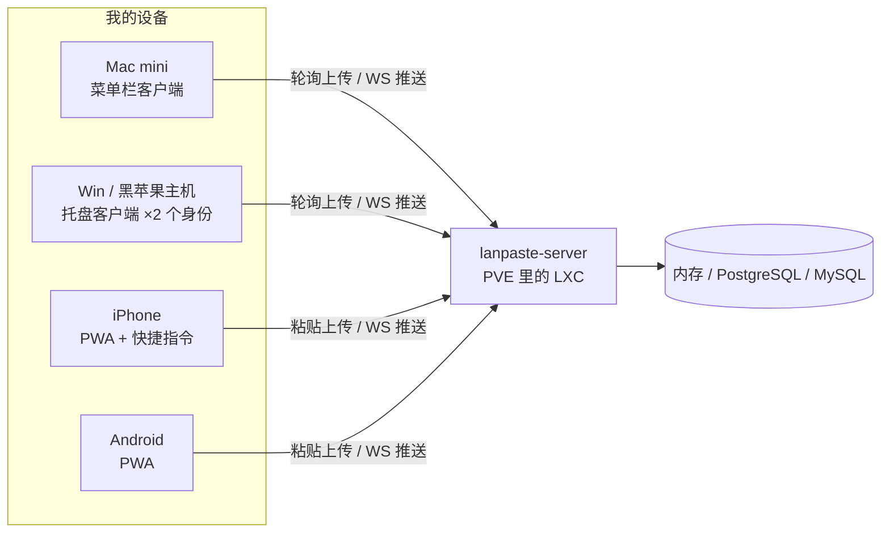

我的设备组合在剪贴板同步这件事上算是最刁钻的一类：

- **Mac mini**：主力开发机，macOS
- **一台 Windows 主机，装着 Win + 黑苹果双系统**——对剪贴板工具来说，它是"两台设备"
- **iPhone 和 Android 手机各一部**
- 家里的 PVE 上跑着各种自托管服务

日常高频场景：Mac 上复制一段代码要贴到 Windows 的 IDEA 里；截图要发到手机上看一眼；手机上收到的验证码要输进电脑。每天几十次，每一次都是摩擦。

<!-- more -->

## 现成工具为什么都不合用

在决定造轮子之前，我把主流方案试了一遍。**没有哪家工具不好，只是我的需求恰好踩在所有工具的软肋上**：

| 工具 | 传输路径 | 我的体验 |
|---|---|---|
| **CrossPaste** | P2P + 订阅中继 | 开源、跨平台、理念很对我胃口，认真试用了一段时间。但可绑定的设备数有限制——**我添加第二台电脑就被卡住了**，更别提后面还要接入 iPhone、Android（双系统主机还得算两个身份）。以我试用的版本为准 |
| **KDE Connect** | 局域网 P2P | 免费开源、走内网，但 iOS 端长期半残，多平台配对繁琐，剪贴板同步也不是它的主业 |
| **Pushbullet 类云同步** | 公网云端 | 免费档限制多；更重要的是剪贴板可能是隐私敏感度最高的数据，我不想让它经过任何第三方服务器 |
| **LocalSend / Snapdrop 类** | 局域网点对点 | 好用，但那是"传文件"的交互——选中、发送、接收。我要的是**感知不到存在的自动同步** |
| **微信文件传输助手** | 公网 | 手动、留痕、还得先发给自己 |

试完之后，我的需求收敛成三条硬指标：

1. **不限设备数**——设备是我的，凭什么要配额
2. **数据不出局域网**——剪贴板内容只在我的设备和我的服务器之间流动
3. **全自动**——复制即同步，没有多余动作

三条同时满足的方案只有一个：自己写一个，跑在自己的服务器上。于是有了 [LAN Paste](https://github.com/thtns/lan-paste)。

## 它是什么：一张架构图



几个设计决定：

- **服务端是 Go 单二进制**（约 17MB，网页端直接内嵌），`scp` + 一条 systemd unit 就是完整部署；存储可以纯内存零配置，也可以在网页向导里点几下切换到家里现有的 PostgreSQL / MySQL
- **桌面客户端三平台**（macOS / Windows / Linux）也是单二进制，macOS 打包成菜单栏应用、Windows 是无窗口托盘程序
- **手机不装 App**——浏览器打开就是完整网页端（PWA 可加到主屏幕），iPhone 还能配快捷指令一键推送/拉取
- **文本 + 图片**都在同步范围内，图片内容寻址存储、天然去重

## 十分钟从零到同步

**服务端**（任意一台 Linux，我家是 PVE 里的 LXC）：

```bash
cd deploy && ./install.sh remote root@<内网IP>
# 编译 + 上传 + 装 systemd 服务，一条命令
```

然后浏览器打开 `http://<内网IP>:8080`，部署向导里选存储（内存 / PostgreSQL / MySQL）、测试连接、保存，全程点选。

**桌面客户端**：双击运行 → 弹出**系统原生设置对话框**（不是浏览器网页！填服务器地址、用户名密码，首次可勾选注册）→ 保存并连接 → 托盘图标出现，开始同步。想开机自启就再执行一次 `-install`。

**手机**：在服务端网页向导里点「手机扫码接入」，扫一下二维码，地址和令牌自动配好；或者手动浏览器打开服务端地址登录，添加到主屏幕当 PWA 用。

## 日常用起来是什么样

没有仪式感，这正是重点：

| 场景 | 操作 |
|---|---|
| Mac 复制代码 → Windows 粘贴 | 正常 Cmd+C，切到 Windows 直接 Ctrl+V |
| 截图发手机看 | 正常截图，手机打开 PWA 就在历史流里（或等推送自动复制） |
| 手机验证码 → 电脑 | 手机上复制，电脑剪贴板 1 秒内就有 |
| 忘了刚才复制过什么 | 网页历史流：按天分组、搜索、按类型筛选、置顶常用 |
| 暂时不想同步 | 托盘菜单「暂停同步」，双向立即停止 |

**双系统主机是我最意外的受益场景**：Win 和黑苹果各自是一个独立的设备身份，共用同一个账号。在 Windows 里复制了东西，重启切到黑苹果，登录后剪贴板内容**自动就在那里**——服务端成了两个系统之间的"摆渡船"。以前双系统传一段文本要靠网盘或微信，现在这个概念从我的工作流里消失了。

## 安全设计：把威胁模型想清楚

剪贴板同步工具天生是"隐私放大器"——它把你复制过的一切集中存放在一个地方。所以安全不是附属功能，是这个工具能不能存在的前提。LAN Paste 的安全模型围绕一个信任边界展开：**家庭局域网**。

**1. 数据不出内网**

服务端只监听内网地址，不连任何外部服务，没有遥测、没有崩溃上报、客户端不集成任何第三方 SDK。剪贴板数据的完整路径只有：你的设备 ⇄ 你的服务器。最坏情况（服务端被内网其他设备攻破）下，泄露范围也被物理网络边界限定。

**2. 账号体系：密码与令牌分离**

- 用户密码 **bcrypt 存储**，服务端数据库泄露也不暴露明文密码
- 每次登录签发**独立的设备令牌**——设备只持有令牌，密码不落任何客户端磁盘
- 令牌文件在本机 `~/.config/lanpaste/config.json`，权限 `0600`
- 早期的共享 Token 保留为**管理令牌**，与设备令牌权限分离（可重置用户密码、进服务端设置页），日常同步不使用它

**3. 用户与设备隔离**

剪贴板按用户隔离——家里多个人用，互相看不到对方的剪贴板；同一账号下的多设备互通。设备令牌可单独注销：换手机、卖电脑时在服务端注销对应令牌，那台设备立刻失效。

**4. 传输层按需升级**

默认 HTTP（内网信任域内够用且零配置）；需要更强时，用 mkcert 签发内网证书 + Caddy 反代上 HTTPS——这时手机 PWA 的自动剪贴板 API 也能用（浏览器要求 Secure Context）。部署目录里附了完整的证书生成脚本和 Caddy 配置。

**5. 部署隔离**

服务端跑在 PVE 的 LXC 容器里，与宿主机和其他服务隔离；数据库复用家里现有的 PostgreSQL / MySQL 实例（独立库 + 独立账号），也可以纯内存运行——不落盘，重启即清空，适合"我只想同步、不想留存"的用法。

**6. 敏感内容的生命周期管理**

剪贴板里最多的就是密码和验证码。服务端支持 **TTL 自动清理**：设一个保留天数（比如 7 天），到期记录连同图片附件一起物理删除。配合网页端的手动删除，做到"敏感内容不永生"。

**7. 开源可审计**

MIT 协议，[全部代码在 GitHub](https://github.com/thtns/lan-paste)。安全声明可以写得天花乱坠，不如代码可查——欢迎审阅、欢迎 issue。

## 写在最后

这个项目目前的形态：服务端 + 三平台客户端 + 网页端共约 1.5 万行 Go，三个存储后端，一套先写契约再写实现的协议（[docs/PROTOCOL.md](https://github.com/thtns/lan-paste/blob/main/docs/PROTOCOL.md)）。规划中的下一步：服务端内置 TLS、端到端加密（服务端只见密文）、Android 原生客户端。

自托管工具的魅力在于：**限制由你自己决定**。设备数量、保留时长、谁能访问、数据在哪——每个问题都有一个你说了算的答案。如果你也有闲置的 NAS 或者软路由，欢迎试试 [LAN Paste](https://github.com/thtns/lan-paste)，issue 和 PR 都欢迎。
