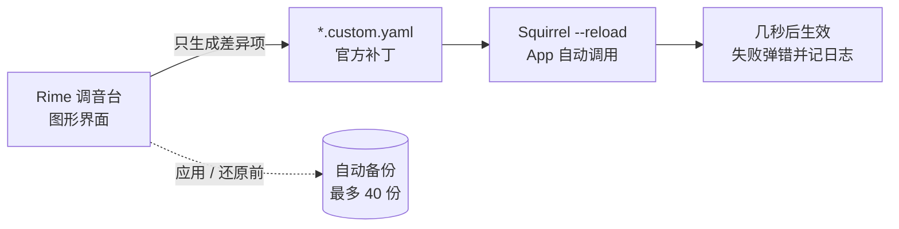

我的 Mac 上有一个用了多年、却一直"半手工驾驶"的软件：[鼠须管](https://github.com/rime/squirrel)（Squirrel）——[Rime](https://rime.im) 输入法在 macOS 上的发行版。我给它配了[雾凇拼音](https://github.com/iDvel/rime-ice)，全拼、中英混输、Lua 扩展样样顺手，几乎所有打字习惯都可以配置。代价是：**所有配置都是 YAML**。想改候选词数量、换皮肤、开模糊音、绑快捷键，都要打开对应的 `.yaml` 文件，找到正确的键，手写几行 patch，再重新部署。每次换机或重装系统，都要重新经历一遍"翻 wiki → 改文件 → 部署 → 看看炸没炸"的循环。

于是我给自己写了一个图形化配置面板：**Rime 调音台**。它不发明新的配置格式，只生成 Rime 官方支持的 `.custom.yaml` 补丁，改完自动调用部署，几秒生效。这篇文章记录它的功能、设计取舍，以及为什么第一个设计决定是"永远不碰原始配置文件"。

<!-- more -->

## 初衷：Rime 什么都能配，除了配置体验

先看我这些年高频重复的操作：

| 想做的事 | 手工操作 |
|---|---|
| 换个皮肤 | 在帖子里抄几十行十六进制色值贴进 `squirrel.yaml`，部署，黑窗了再逐行排查 |
| 开几个模糊音 | 回忆 `speller/algebra` 的 `derive` 写法，手写正则 |
| 绑一个翻页键 | 翻文档确认 `Page_Up` 这类键名的准确拼写，手写 `key_binder` |
| 改候选词数量 | 找到该写在 `default` 还是方案文件里，再想想补丁路径对不对 |
| 两台 Mac 同步词库 | 配 `installation.yaml`、认快照目录、跑 `Squirrel --sync`，每步都是命令行 |

不是做不到，而是**每个小改动都要一次"打开文档"的仪式**。Rime 本身像一台专业调音设备：旋钮全都在，功能强到离谱，但它出厂不带面板。Rime 社区其实早就给出了体面的扩展机制——`.custom.yaml` 补丁，官方支持的覆盖方式，升级配置也不丢。只是补丁仍然要手写 YAML。

所以"调音台"的定位很克制：**不发明格式、不接管 Rime，只是把旋钮做成看得见的开关**。免费开源，全部逻辑都在本机运行，没有遥测也没有账号。

## 第一条设计原则：永不修改原始配置

App 从头到尾只新增或更新这五个文件：

| 文件 | 内容 |
|---|---|
| `squirrel.custom.yaml` | 外观与皮肤 |
| `default.custom.yaml` | 候选数量、按键绑定、方案列表 |
| `rime_ice.custom.yaml` | 模糊音、Lua 引擎开关 |
| `custom_phrase.txt` | 自定义短语 |
| `installation.yaml` | 同步设备标识与同步目录（仅启用同步时） |



原始的 `default.yaml`、`squirrel.yaml` 一个字都不会动，带来的好处是成套的：

- **补丁只保存与原值不同的项**。某一项改回原值，对应的覆盖会被自动移除，不会留下僵尸配置；
- **手写的补丁项会保留**。如果你在 `.custom.yaml` 里自己维护过其他 `patch` 项，App 不认识的一律不动（注释和顺序可能被重写，内容不丢）；
- **回滚 = 删补丁**。「关于与维护」里有一键清除各类补丁，重新部署即回到原样；
- **每次应用、还原前自动备份**，最多保留 40 份，存放在 `~/Library/Application Support/RimeTuner/backups/`，可随时还原。

## 皮肤：从"抄色值"到分享码

外观是最高频的需求，也是手写 YAML 最容易翻车的区域。调音台把整件事变成了可视操作：

- **实时候选窗预览**：颜色、字体、字号、圆角、行距、排列方式，拖一个滑块右边立刻变，不用"改了部署、打几个字看看、再改"；
- **大图皮肤选择器**：卡片预览、按名称/作者搜索，一键切换；外观模式可跟随系统、固定浅色或固定深色；
- **布局全套可调**：堆叠/单行、横排/竖排、编码内嵌、选中词内嵌，以及阴影、磨砂、贴边、翻页箭头这些细节项。

我最喜欢的是**皮肤分享码**：一键把当前外观打包成一段 `RTS1.…` 文本。对方在「导入皮肤码」里粘贴，就能得到一模一样的皮肤——**配色板完整内嵌，不需要安装同款皮肤**，也可以存成文本文件传播。动机很简单：Rime 的好皮肤散落在各种帖子和 gist 里，分享=发 YAML 文件让对方自己粘；有了分享码，就是"发一段码，粘贴即得"。编码带了校验，内容被篡改过会拒绝导入。

顺带一提实现细节：「跟随系统」会保留亮色、深色两套皮肤；「始终深色」则是把两套都设成同一个深色皮肤——全部落在官方配置能力之内，没有黑魔法。

## 打字习惯：临时英文、模糊音、快捷键、Lua

**临时英文**是我自己每天用最多的功能。按一下左 Shift → 输入单词 → 回车，单词上屏后自动回到中文状态，全程不切换中英模式。装了雾凇 `melt_eng` 的话，中途直接打英文单词，候选里也会给出英文，选中后继续中文。左/右 Shift、左/右 Control 四个键的 behaves 都可以单独定义（临时英文、上屏并切换、清空并切换、切换模式……），甚至处理了"已有拼音时先上屏或 Esc 再按 Shift"这种边角稳定性。

**模糊音**是纯勾选：zh/ch/sh ↔ z/c/s、n ↔ l、f ↔ h、l ↔ r、an/ang、en/eng、in/ing、ian/iang、uan/uang，勾完写入 `rime_ice.custom.yaml`。只影响全拼（雾凇）；双拼方案有自己的 `speller/algebra`，不受影响也不会被误改。

**快捷键**页面有一个 168 个 Rime 键名的全量选择器：涵盖特殊键（`Page_Up`、`KP_Enter`、`Hyper_L`…）、标点、小键盘、F1–F24 和修饰键，可搜索、可叠加 Control/Shift/Alt/Super。方案选单、上一页/下一页（每项可绑多个键）、中英标点、简繁、Emoji、全角、以词定字的首字/尾字键，全部写入 `default.custom.yaml` 的 `key_binder`。

**Lua 扩展**把雾凇拼音的翻译器和滤镜做成了开关：日期、农历、UUID、Unicode、数字大写、计算器、错音提示、英文自动大写、置顶候选、长词优先、英文降权……改的是 `engine` 列表，也能浏览 `lua/` 目录、直接在编辑器里打开脚本。方案管理则支持启用/停用、拖动排序、设为默认，`custom_phrase.txt` 做成了可搜索的表格编辑。

## 多机同步：Nextcloud 直连，或者任意文件夹

Rime 的同步机制本身设计得其实很干净：`installation.yaml` 里给每台设备一个标识和一个同步目录，`Squirrel --sync` 把用户词典快照写进去，各设备互相合并。它不绑定任何云盘——只是大多数人卡在"这几步全是文件和命令行"。

调音台给了两条路：

1. **Nextcloud WebDAV 直连**。App 内置了 WebDAV 客户端，填服务器地址、用户名、应用密码和远程文件夹，直接拉取/上传快照，**不需要安装 Nextcloud 桌面客户端**。应用密码存在 Keychain 里，HTTPS 自签名证书可以显式允许。
2. **任意本地文件夹**。iCloud Drive、Dropbox、OneDrive、坚果云、NAS 挂载卷、Syncthing、U 盘——你已有的任何同步方式都行，App 提供这些目录的快捷入口。

两条路里的同步顺序都一样：**下载其他设备快照 → 调用 Rime 合并用户词典 → 上传本机快照**，也可以单独一键 `Squirrel --sync`。同步目录里有哪些设备、用户词典多大、上次同步是什么时候，都能直接看到。

一个要诚实交代的边界：**Rime 同步只交换用户词典**。`custom_phrase.txt`、方案和自定义词典文件不在同步范围内——想连配置一起共享，得把整个 `~/Library/Rime` 放进云盘或 Git，并避免两台设备同时修改。

## 写给自己也写给 reviewer：测试怎么做

改的是用户天天在用的输入法配置，不敢只靠"我机器上没问题"：

- **64 项核心自检**（`--self-test`）：YAML 解析与补丁往返、按键绑定生成、皮肤码提取/编码往返/防篡改/导入注册等；
- **真实文件交叉验证**：自写的 YAML 解析器与 Ruby Psych 对全部 21 个真实配置文件逐一比对，结果一致；
- **端到端部署测试**（仅 DEBUG 构建）：`--apply-test` / `--feature-test` / `--sync-test` 会临时改写真实配置、真实部署、再还原；
- **WebDAV 客户端**对本地 mock 服务验证过上传、下载和远程独有文件拉取。

整个项目是单仓 Swift（SwiftUI 界面 + 自写的 Rime YAML 子集解析器），约 9100 行。GitHub Actions 做了两件事：PR 构建检查，以及打 tag 后自动产出 x86_64 + arm64 通用 DMG。

## 已知限制

- 模糊音只写入雾凇（`rime_ice`）；自然码、小鹤等双拼方案的模糊音要单独处理，暂未覆盖；
- Lua 页面管理的是雾凇拼音的引擎列表，不覆盖其它方案自己的 `engine`；
- 同步只含用户词典，不含自定义短语、方案和自定义词典；
- 需要 macOS 14 及以上；
- Caps Lock 如果被系统"使用大写锁定键切换 ABC"拦截，App 里的对应设置可能不生效。

## 安装

前提：先安装[鼠须管](https://github.com/rime/squirrel)并至少部署过一次。

到 [GitHub Releases](https://github.com/thtns/rime-tuner/releases) 下载 DMG（通用二进制，Intel/Apple Silicon 都可用），拖进 Applications 即可。打包用的是 ad-hoc 签名，第一次打开会被 Gatekeeper 拦：右键 App → 打开，或者执行：

```bash
xattr -dr com.apple.quarantine "/Applications/Rime 调音台.app"
```

源码在 [github.com/thtns/rime-tuner](https://github.com/thtns/rime-tuner)，`swift build` 即可自己编译，`--self-test` 可以跑上面提到的全套自检。

## 写在最后

Rime 的哲学是把所有旋钮都交给你；这个 App 做的事情，只是让旋钮**看得见、拧得动，并且随时能转回去**。它解决的是我自己的问题——如果你也在用鼠须管、也受够了手写 YAML，欢迎试试；双拼模糊音之类的需求，来 [issue](https://github.com/thtns/rime-tuner/issues) 里聊。
